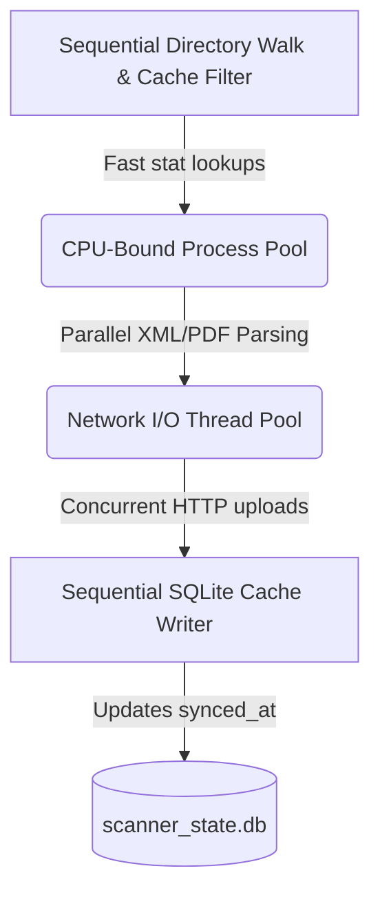

# MyLibrary - Sync Scanner Performance & Efficiencies

This document outlines the performance optimizations implemented in the MyLibrary Off-Webpage Sync Scanner ([sync_files.py](file:///p:/Documents/GitHub/MyLibrary/scanner/sync_files.py)) to process thousands of books, magazines, and digital publications rapidly and reliably.

---

## 1. Core Architecture Optimizations

To handle large libraries (15,000+ files) across network drives, the sync scanner divides its execution into three distinct, specialized phases to resolve separate processing bottlenecks:



---

## 2. Phase Breakdown

### Phase 1: Rapid Walk & Cache Filtering (Sequential)
* **Bottleneck**: Crawling directories over network mounts (e.g., `P:\`) can have high metadata latency.
* **Optimization**: The walk performs a minimal sequential directory crawl checking file sizes and modification timestamps against the SQLite cache. Unchanged files are filtered out immediately without opening or hashing them.
* **Benefit**: Reduces disk read operations to the absolute minimum.

### Phase 2: Parallel Metadata Extraction (CPU-Bound)
* **Bottleneck**: Hashing files (SHA-256) and parsing structural details (decompressing EPUB zips, parsing PDF encryption/metadata structures) is highly CPU-bound. In a single-threaded scanner, this is the slowest part of the pipeline.
* **Optimization**: Uses a `ProcessPoolExecutor` to spin up parallel worker processes (one per CPU core) to hash and extract metadata.
* **Why Multiprocessing?**: Python's Global Interpreter Lock (GIL) limits performance on multi-threaded CPU tasks. Using separate processes bypasses the GIL and utilizes all available CPU cores.
* **Resilience**: Falls back gracefully to sequential single-process parsing if a process execution error occurs.

### Phase 3: Concurrent Network Uploads (I/O-Bound)
* **Bottleneck**: Submitting metadata via HTTP POST to the central Django web application requires waiting for network handshakes, database writes, and fuzzy matching calculations. Sequential requests waste CPU time waiting on network latency.
* **Optimization**: Employs a `ThreadPoolExecutor` (configured with `max_workers=8`) to execute HTTP posts concurrently.
* **Benefit**: Keeps the connection pipeline fully saturated, drastically reducing total sync duration.

---

## 3. Database Integrity & Locking Prevention

* **Problem**: SQLite does not support high-concurrency writes. Writing to `scanner_state.db` concurrently from multiple threads would cause database lock contention (`database is locked` operational errors).
* **Solution**: While HTTP uploads are performed concurrently across background threads, the resulting state writes are processed **sequentially in the main thread** as tasks finish:
  ```python
  for future in as_completed(upload_tasks):
      abspath, modified_at, size, file_hash, success = future.result()
      if success:
          # Safe sequential write back to SQLite in the main thread
          update_cached_state(abspath, modified_at, size, file_hash)
  ```

---

## 4. Shared Caching Drive with Graceful Fallback
* **Unified State**: Storing the `scanner_state.db` on the shared drive (e.g., `P:\scanner_state.db`) allows different scanning machines to share the sync cache.
* **Fault Tolerance**: If the configured drive path is offline or unmounted, the script automatically catches the missing directory and falls back to a local cache within the scanner repository directory to prevent execution failure:
  ```python
  if not db_dir or os.path.exists(db_dir):
      DB_PATH = configured_path
  else:
      print("Warning: Directory does not exist. Falling back to local state DB.")
  ```
